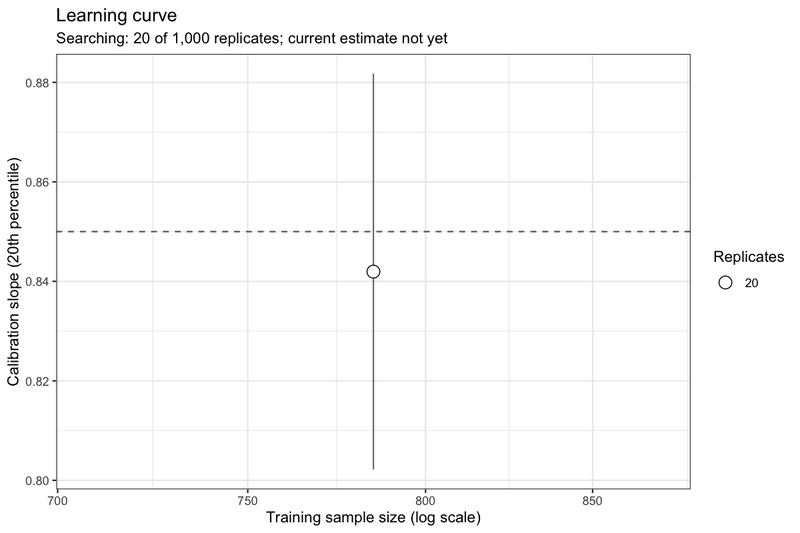

```{r}
#| label: setup
#| include: false
knitr::opts_chunk$set(
  collapse = TRUE,
  comment = "#>",
  fig.width = 6, fig.height = 4,
  warning = FALSE,
  message = FALSE
)
```

## What pmsims does

**pmsims** estimates the **minimum sample size** needed to develop a
prediction model to achieve a target level of performance **with
assurance**. Rather than relying on simple rules of thumb or closed‑form
formulae, pmsims uses **simulation** to:

-   Generate synthetic datasets that reflect your target setting
    (outcome type, prevalence or $R^2$, signal vs. noise predictors,
    and how complex the underlying signal is);
-   Fit a specified **model** (e.g., logistic regression or linear
    regression);
-   Evaluate a chosen **performance metric** (e.g., calibration slope,
    AUC); and
-   Trace a **learning curve** of performance as the training size
    increases.

<p align="center">
  
</p>

The recommended design objective is **assurance**: the **smallest** $n$
such that a high proportion of repeated studies (e.g., 80%) meet the
target performance. In pmsims, this is implemented via the **20th
percentile** of the simulated performance distribution at each $n$.

## Required inputs at a glance

There are three wrapper functions for binary, continuous, and survival
outcomes, respectively:

- `simulate_binary()`
- `simulate_continuous()`
- `simulate_survival()`

All three take the same core inputs:

| Argument | Default | Description |
|------|------|--------------|
| `signal_parameters` | required | Number of predictors associated with the outcome |
| `noise_parameters` | `0` | Number of predictors unrelated to the outcome |
| `complexity` | `1` | Signal structure: `1` linear, `2` adds quadratic terms, `3` adds an interaction, `4` the Friedman function |
| `data_control` | `NULL` | Correlation, distribution and nonlinear strength of the predictors (see `simulate_binary()`) |
| `model` | `"glm"`, `"lm"` or `"coxph"` | Model fitted to each simulated dataset (the penalised and machine-learning options are experimental) |
| `metric` | `"calibration_slope"` | Performance metric: `"calibration_slope"`, `"auc"`, `"r2"`, `"cindex"` or `"csse"` |
| `target_performance` | required | Minimum acceptable performance |
| `n_reps_total` | `1000` | Total number of simulation replicates |
| `mean_or_assurance` | `"assurance"` | Criterion used to choose the sample size |

The remaining inputs depend on the outcome:

| Function | Outcome-specific inputs | Models |
|------|--------------|----------|
| `simulate_binary()` | `maximum_achievable_cstatistic`, `outcome_prevalence` | `"glm"`, `"lasso"`, `"ridge"`, `"rf"`, `"xgboost"` |
| `simulate_continuous()` | `maximum_achievable_rsquared` | `"lm"`, `"lasso"`, `"ridge"`, `"rf"`, `"xgboost"` |
| `simulate_survival()` | `maximum_achievable_cindex`, `censoring_rate`, `baseline_hazard` (optional; default `1`) | `"coxph"`, `"lasso"`, `"ridge"`, `"rf"`, `"xgboost"` |

> Notes:
>
> - `maximum_achievable_*` represents the best plausible performance with
>   effectively unlimited data and calibrates the data generator.
> - `target_performance` is the minimum acceptable performance threshold used
>   to determine the required sample size.
> - `complexity` and `data_control` describe the data-generating mechanism, not
>   the model you plan to fit. The same configuration is used both to calibrate
>   the generator against `maximum_achievable_*` and to simulate the data, so a
>   more complex signal generally implies a larger required sample size.
> - For reproducibility, set a random seed (`set.seed()`).

## Installation

Install the stable release from [CRAN](https://CRAN.R-project.org/package=pmsims):

```{r}
# install.packages("pmsims")
library(pmsims)
```

## Binary-outcome example

We target the smallest *n* that meets the **assurance** criterion.

```{r}
#| echo: true
#| eval: false
set.seed(123)

binary_example <- simulate_binary(
  signal_parameters = 20,
  noise_parameters  = 0,
  complexity = 1,
  data_control = list(correlation = 0.3),
  outcome_prevalence = 0.30,
  maximum_achievable_cstatistic = 0.80,
  model = "glm",
  metric = "calibration_slope",
  target_performance = 0.85,
  n_reps_total = 1000,
  mean_or_assurance = "assurance"
)

binary_example
```

```{r Run binary}
#| echo: false
# `binary_example` is the result of the call above, shipped with the package.
print(binary_example)
```

The printed summary is a human-readable report. Implementation detail --- the
internal metric identifiers, the engine settings used for the search, and any
quantities recorded on an internal search scale --- is available through
`summary(binary_example)` or, equivalently,
`print(binary_example, verbose = TRUE)`.

Plot the estimated learning curve and identified sample size:

```{r}
#| eval: false
plot(binary_example)
```

The animation below shows the same search as it ran. With
`live_plot = TRUE`, the plot is redrawn after each batch of 20 replicates.
The final frame is what `plot(binary_example)` draws: the 20th percentile of
the calibration slope at each simulated sample size (point size shows the
number of replicates, with ±2 standard errors), the fitted learning curve,
the target (dashed line), the minimum sample size (solid line) with its
interval (shaded), and a shape-free cross-check (dotted line).

<p align="center">
  
</p>

## How the search works

By default (`method = "curve"`), `pmsims` fits a learning curve,
$C(n) = a - b n^{-c}$, to the criterion at every sample size simulated so
far. A pilot doubles or halves $n$ until the criterion has been seen on both
sides of the target. Each further batch is placed where the fitted curve
crosses the target, and the answer is where the final curve crosses it. The
answer is then simulated again with fresh replicates to check that it meets
the target.

Every result has a `status`. `"ok"` means a sample size was found and the
check confirmed it. Otherwise `min_n` may be `NA`, and `status_message`
explains why (for example, `"unreachable"` when the curve levels off below
the target). The previous Gaussian-process engine is available with
`method = "mlpwr"`; see `?simulate_custom` for details of both engines.

## Continuous-outcome example

```{r}
#| echo: true
#| eval: false
continuous_example <- simulate_continuous(
  signal_parameters = 15,
  noise_parameters = 0,
  complexity = 1,
  data_control = list(correlation = 0.3),
  maximum_achievable_rsquared = 0.50,
  model = "lm",
  metric = "calibration_slope",
  target_performance = 0.95,
  n_reps_total = 1000,
  mean_or_assurance = "assurance"
)

continuous_example
```

```{r}
#| echo: false
# `continuous_example` is the result of the call above, shipped with the package.
print(continuous_example)
```

```{r, fig.alt="Plot showing learning curve for continuous outcome"}
plot(continuous_example)
```
